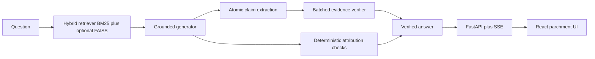
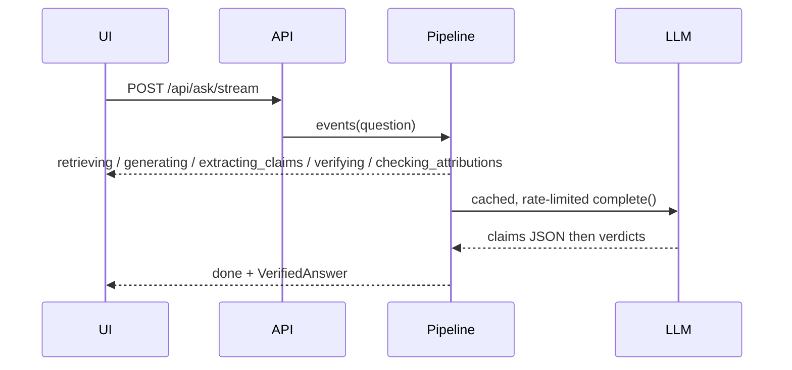

# Architecture

Provider calls go through `iks_verify.llm`: disk cache, asyncio rate limiter (injectable clock/sleep), 429 backoff, optional fallback provider. Claim verification batches all claims in one judge call. Self-check samples default to `SELFCHECK_SAMPLES=3`. Attribution flags (fabricated citations, Sanskrit mismatch) do not use an LLM.
